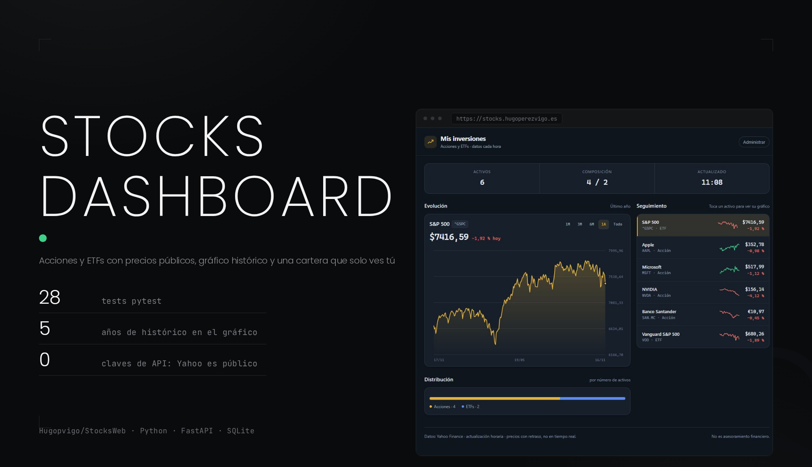
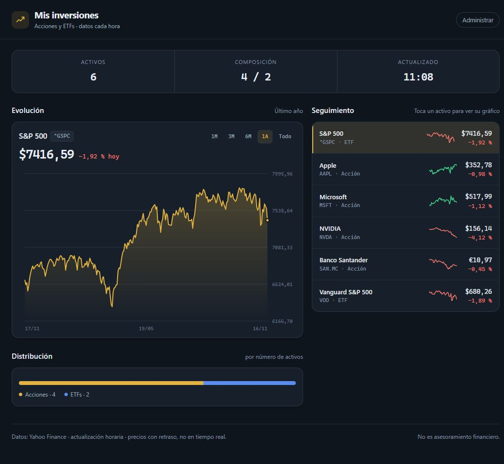
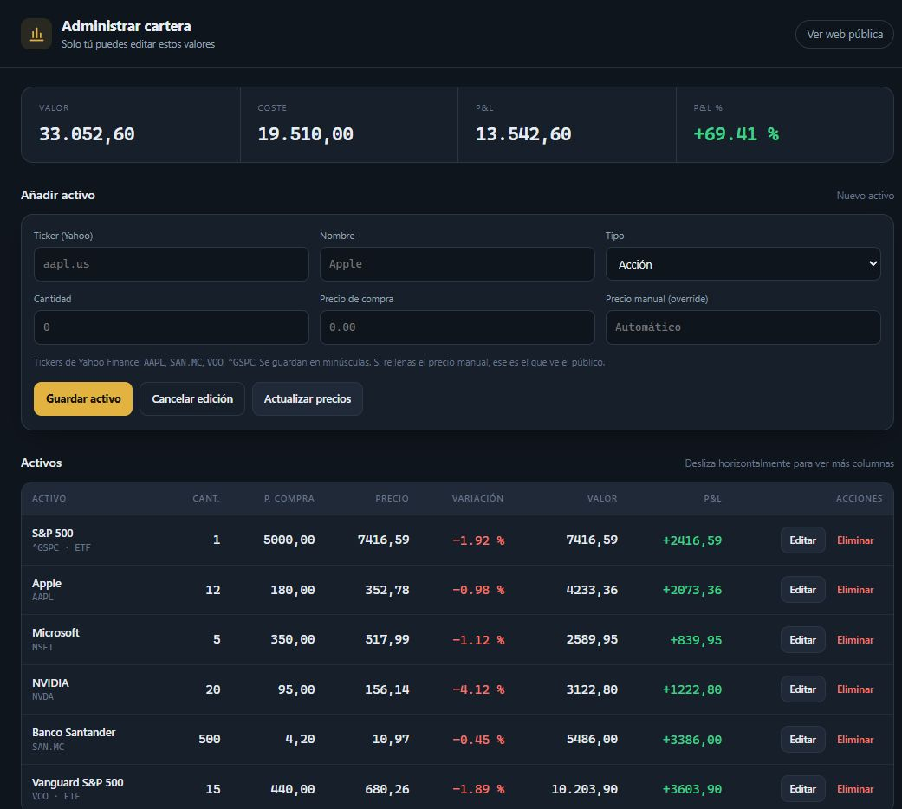
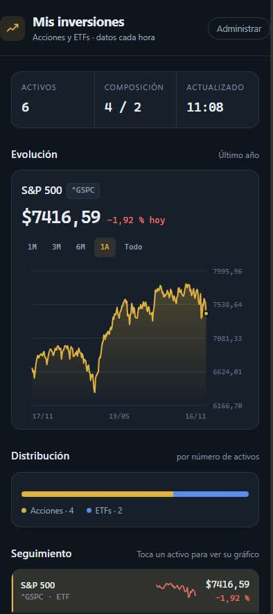

<meta property="og:title" content="STOCKS DASHBOARD">
<meta property="og:description" content="Un dashboard para seguir tus acciones y ETFs con datos públicos, actualizados cada hora.">
<meta property="og:image" content="https://raw.githubusercontent.com/Hugopvigo/StocksWeb/main/docs/capturas/og.png">

<p align="center">
  
</p>

<p align="center">
  
</p>

<p align="center">
  <b>Un dashboard para seguir tus acciones y ETFs en un solo sitio.</b><br>
  Precios con retraso de Yahoo Finance, gráfico histórico, variación diaria y tu cartera detrás de una contraseña.
</p>

<p align="center">
  
  
  
  
  
  
</p>

---

## Qué es esto

**Stocks Dashboard** es una web pública de solo lectura donde se ven los precios,
la variación diaria y el histórico de las acciones y ETFs que sigues, más un
**admin privado** donde tú gestionas la lista y tus números reales.

Nace de una necesidad concreta: ver la cartera en el móvil sin depender de apps
de terceros, con datos públicos **sin realtime** (no hace falta pagar por
cotizaciones en vivo para ver cómo va un ETF a largo plazo).

- **Web pública**: precios, variación, gráfico de 1M/3M/6M/1A/5A y distribución
  por tipo de activo. Solo lectura: nadie puede cambiar nada.
- **Admin con contraseña**: altas, bajas, cantidades, precio de compra, P&L y un
  campo de **precio manual (override)** que gana siempre sobre el valor de la API.
- **Lo privado no se filtra**: la API pública nunca devuelve cantidades,
  importes ni ganancias (hay un test que lo garantiza).
- **Sin claves de API**: Yahoo Finance es público; la contraseña vive solo en
  un `.env` del servidor (600), fuera del repo.

Está desplegado en **[stocks.hugoperezvigo.es](https://stocks.hugoperezvigo.es/)**.

## Pantallas

| | |
|---|---|
|  |  |
| **Escritorio**: evolución a la izquierda, lista de seguimiento a la derecha y distribución debajo del gráfico. | **Admin**: totales, formulario de activos y tabla con valor y P&L por posición. |
| <div align="center"></div> | |
| **Móvil**: mismo contenido reordenado en una sola columna, con el gráfico y la distribución antes de la lista. | |

## Qué hace

| | |
|---|---|
| **Cotizaciones** | Precio y variación diaria de cada activo, actualizados cada hora. |
| **Gráficos** |Histórico de 5 años con rangos 1M/3M/6M/1A/5A y tooltip al pasar el cursor. |
| **Seguimiento** | Lista con sparkline por activo; tocar uno cambia el gráfico principal. |
| **Distribución** | Barra con el reparto entre acciones y ETFs. |
| **Cartera** | (solo admin) Cantidad, precio de compra, valor, P&L y porcentaje por activo y total. |
| **Override** | (solo admin) Precio manual: si lo rellenas, ese es el que ve el público. |
| **Actualizar** | Botón en el admin para forzar la descarga de precios sin esperar al cron. |
| **Resiliencia** | Si un ticker falla, se conserva su último precio y se muestra el error en el admin; los demás siguen. |
| **Acceso** | Basic Auth en `/admin` y en toda la API de administración. |

## Compilar y probar

Necesitas Python 3.12 o superior.

```bash
git clone https://github.com/Hugopvigo/StocksWeb.git
cd StocksWeb
python -m venv .venv
source .venv/bin/activate          # Windows: .venv\Scripts\activate
pip install -r requirements-dev.txt
```

Sin credenciales no hace falta configurar nada para la web pública:

```bash
pytest -q                          # 28 tests
uvicorn app.main:app --reload --port 8000
```

Abre `http://127.0.0.1:8000/`. Para el admin, define las credenciales:

```bash
ADMIN_USER=admin ADMIN_PASSWORD=clave uvicorn app.main:app --reload --port 8000
```

Para poblar la BD local, entra en `/admin` y añade tickers de Yahoo: `AAPL`,
`SAN.MC`, `VOO`, `^GSPC`… **sin sufijo `.us`** (ese sufijo es de Stooq y en Yahoo
da 404).

## Con qué está hecha

| | |
|---|---|
| Lenguaje | Python 3.12 |
| API y servidor | FastAPI + Uvicorn (un solo contenedor) |
| Datos | Yahoo Finance, API pública de `chart`, sin clave |
| Persistencia | SQLite en un volumen Docker |
| Gráficos | SVG propio (sin librerías de JavaScript) |
| Frontend | HTML + CSS + JavaScript vanilla, mobile-first |
| Seguridad | Basic Auth, whitelist de IPs de la flota, fail2ban, Cloudflare |
| Tests | pytest (28 tests) |

## Estructura

```
StocksWeb/
├── app/
│   ├── main.py        rutas, autenticación, scheduler horario
│   ├── provider.py    Yahoo Finance: URL y parseo del JSON
│   ├── market.py      orquestación del refresco y tolerancia a fallos
│   ├── service.py     reglas de negocio (override, variación, totales)
│   ├── views.py       respuesta pública (sin datos privados) y admin
│   └── db.py          SQLite: esquema y consultas
├── static/            HTML, CSS, JS y gráficos SVG
├── tests/             28 tests (API, BD, proveedor, servicio, refresco)
├── docs/capturas/     capturas del README
├── Dockerfile
├── docker-compose.yml
├── apache-vhost.conf.example
├── PRODUCT.md / DESIGN.md
└── infra/ingress-cf.json   reglas del firewall de Oracle (rangos de CF)
```

La regla de oro: **`views.public_dashboard()` es la única frontera de datos**.
Si algo no está explícitamente ahí, el público no lo ve.

## Despliegue

El detalle paso a paso está en el propio README del repo de infraestructura.
Resumen para el VPS personal (Oracle Cloud, ARM, Apache + Cloudflare):

```bash
# En el servidor
cd /opt/StocksWeb
# .env con ADMIN_USER / ADMIN_PASSWORD (600)
docker compose up -d --build
# vhost Apache → 127.0.0.1:8083, DNS CNAME stocks → hugoperezvigo.es (proxied)
```

Dos trampas del entorno que ya están resueltas en el compose:

- El DNS interno de Docker no resuelve hosts externos en este VPS (Oracle
  reenvía al metadata `169.254.169.254`), así que el contenedor usa
  `network_mode: host` y la app escucha en `127.0.0.1:8083`.
- Docker no recarga `env_file` al editar `.env`: tras cambiar credenciales,
  `docker compose up -d --force-recreate --no-build`.

El puerto 8083 no está expuesto: solo Apache lo alcanza desde localhost, y la
Security List de Oracle solo acepta los rangos de Cloudflare en 80/443.

## Estado

En producción desde noviembre de 2026. Funcionando:

- Web pública y admin, con datos reales y actualización horaria.
- 28 tests en verde y detector de diseño sin hallazgos.
- Perímetro cerrado: el origen solo es alcanzable desde Cloudflare.

Fuera de alcance a propósito: cotizaciones en tiempo real, alertas, más de un
usuario, y edición desde la web pública.

## Licencia

MIT.

---

<p align="center">
  Desarrollado por <a href="https://github.com/Hugopvigo">Hugo Perez-Vigo</a> · <a href="https://x.com/hugopvigo">@hugopvigo</a>
</p>
